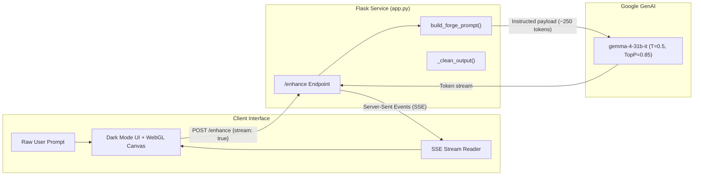

# FORGE — Precision Prompt Engineering System

[](https://python.org)
[](https://flask.palletsprojects.com/)
[](https://ai.google.dev/)
[](https://www.docker.com/)
[-brightgreen)](#testing)
[](LICENSE)

**FORGE** is a lightweight, low-latency prompt enhancement platform. It transforms rough, underspecified user inputs into structured, high-performance prompts tailored for large language models. Powered by Google's `gemma-4-31b-it` via the `google-genai` SDK and served by an asynchronous, SSE-streaming Flask backend.

---

## Architecture Overview



### Key Efficiency Improvement
* **Zero-Shot Meta-Prompting Architecture**: Employs direct prompt engineering instructions (~150–300 tokens per request) compared to legacy template-injection architectures (~15,000 tokens per request), drastically decreasing token overhead and latency.

---

## Features

- **Real-Time Token Streaming**: Low-latency token generation powered by Server-Sent Events (`text/event-stream`).
- **Structured Refinement**: Enforces clear roles, contextual framing, step-by-step guidance, and explicit output constraints without answering or resolving the user's task.
- **Output Sanitization**: Automated regex cleaning pipeline that strips echoed internal template tags and redundant structural dividers.
- **Dynamic Frontend**: Single-page application styled with Tailwind CSS, custom WebGL interactive fluid dynamics background, custom trailing cursor, and real-time markdown formatting.
- **Multi-Format Export**: Quick clipboard export for formatted Markdown or structured JSON.
- **Keyboard Shortcuts**: Built-in keyboard accessibility (`Cmd/Ctrl + Enter` to enhance, `Esc` to clear, `/` to focus input, `?` for shortcut modal).
- **Production Containerization**: Multi-stage, non-root `Dockerfile` with automated health checks and `docker-compose.yml`.

---

## Tech Stack

- **Backend**: Python 3.10+, Flask 3.0.3, Gunicorn 22.0.0, python-dotenv
- **AI / LLM Integration**: Google GenAI SDK (`google-genai>=1.0.0`), `gemma-4-31b-it`
- **Frontend**: HTML5, Vanilla JavaScript (ES6+), Tailwind CSS (CDN), WebGL Shaders (Splash Cursor simulation)
- **Testing & Quality**: Pytest 8.1+, Pytest-Asyncio, Ruff
- **Containerization & CI/CD**: Docker, Docker Compose, GitHub Actions

---

## Project Structure

```text
forge/
├── .github/
│   └── workflows/
│       └── ci.yml               # GitHub Actions CI matrix (Py 3.10-3.12)
├── docs/
│   ├── api.md                   # Complete REST & SSE API specification
│   ├── architecture.md          # In-depth architectural & data-flow documentation
│   ├── deployment.md            # Production deployment (Docker, Gunicorn, Nginx)
│   └── setup.md                 # Local development & troubleshooting guide
├── scripts/
│   └── verify_environment.py    # Pre-flight environment check script
├── templates/
│   └── index.html               # Frontend SPA (UI, WebGL canvas, SSE parser)
├── tests/
│   ├── __init__.py
│   ├── conftest.py              # Pytest fixtures & GenAI mocks
│   └── test_app.py              # Unit & integration test suite (12 tests)
├── .dockerignore
├── .env.example                 # Environment configuration template
├── .gitignore                   # Comprehensive git exclusions
├── app.py                       # Flask application & GenAI pipeline
├── docker-compose.yml           # Docker Compose configuration
├── Dockerfile                   # Production container definition
├── LICENSE                      # MIT License
├── README.md                    # Project documentation
├── requirements.txt             # Production dependencies
└── requirements-dev.txt         # Development & testing dependencies
```

---

## Requirements

- Python 3.10 or higher
- A Google Gemini API key ([Get an API key from Google AI Studio](https://aistudio.google.com/))

---

## Installation & Setup

### 1. Clone the Repository
```bash
git clone https://github.com/your-username/forge.git
cd forge
```

### 2. Set Up Virtual Environment
```bash
# Linux/macOS
python3 -m venv .venv
source .venv/bin/activate

# Windows
python -m venv .venv
.venv\Scripts\activate
```

### 3. Install Dependencies
```bash
pip install -r requirements-dev.txt
```

### 4. Configure Environment
Copy the example `.env.example` to `.env` and set your Gemini API key:
```bash
cp .env.example .env
```
Edit `.env`:
```env
GEMINI_API_KEY=your_actual_gemini_api_key_here
PORT=5000
FLASK_DEBUG=false
```

### 5. Verify Setup
Run the pre-flight verification script:
```bash
python scripts/verify_environment.py
```

---

## Usage

### Run Locally (Development)
```bash
python app.py
```
Open your browser at `http://localhost:5000`.

### Run via Docker
```bash
# Using Docker CLI
docker build -t forge .
docker run -p 5000:5000 -e GEMINI_API_KEY="your_api_key_here" forge

# Or using Docker Compose
docker compose up -d
```

---

## API Reference

### Health Check
`GET /health`
```json
{
  "status": "ok",
  "templates_loaded": 0,
  "model": "gemma-4-31b-it"
}
```

### Prompt Enhancement
`POST /enhance`
* **Headers**: `Content-Type: application/json`
* **Body**:
  ```json
  {
    "prompt": "Write a python script to scan network ports.",
    "stream": true
  }
  ```
* **Streaming Response (`stream: true`)**: Returns SSE data chunks:
  ```text
  data: {"chunk": "Act as a senior network security engineer...\n"}
  ...
  data: {"done": true}
  ```
* **Non-Streaming Response (`stream: false`)**: Returns full JSON payload with `enhanced_prompt`, `score`, and `domain`.

*See [docs/api.md](docs/api.md) for full endpoint specifications and error codes.*

---

## Testing

The project includes an automated test suite verifying prompt builders, output sanitization, error handlers, mock streams, and HTTP routes.

```bash
# Run all tests
pytest -v

# Run with linter check
ruff check .
```

---

## Limitations

- **Upstream Rate Limits**: Subject to Google GenAI quota limits and throughput constraints.
- **Prompt Size**: Output generation is bounded by `max_output_tokens=1280`.
- **Single Model Backend**: Configured for `gemma-4-31b-it`. Multi-model switching is not implemented in the current codebase.

---

## Future Improvements

- [ ] Support for model selection dropdown (e.g., Gemini 1.5 Flash, Gemini 1.5 Pro, Gemma 2).
- [ ] User prompt history saved locally in `localStorage` or session cache.
- [ ] Direct side-by-side prompt version comparison and evaluation diffs.
- [ ] Configurable system persona presets (e.g., Code Specialist, Creative Writing, Technical Architecture).

---

## License

This project is licensed under the terms of the [MIT License](LICENSE).
