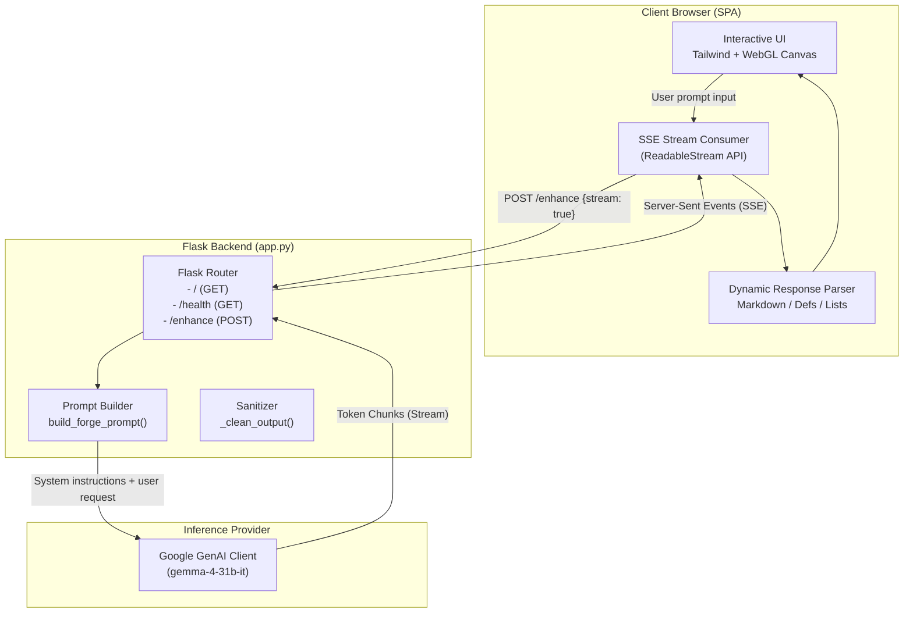
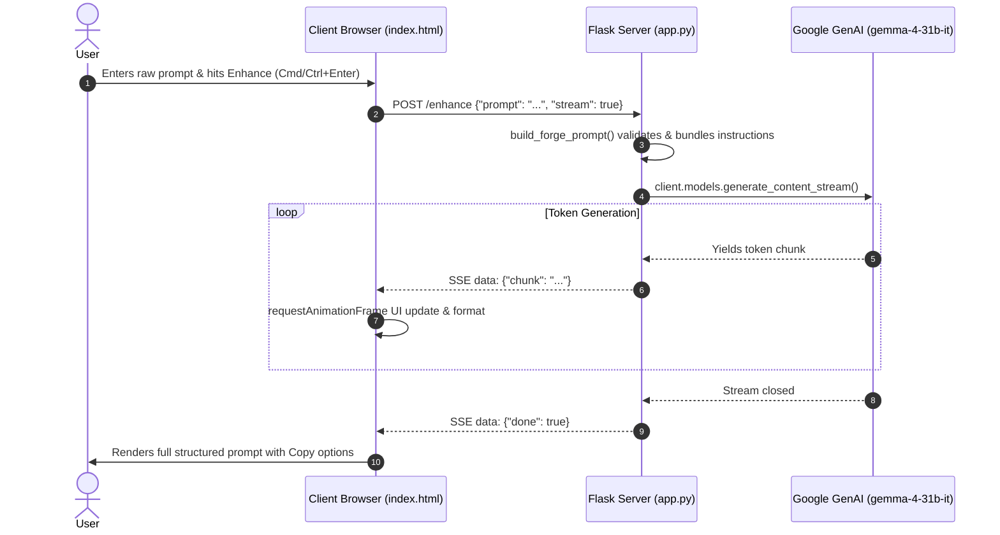

# FORGE System Architecture

This document provides a technical breakdown of the **FORGE** prompt engineering and enhancement platform.

---

## 1. High-Level System Architecture

FORGE operates as a lightweight, low-latency prompt refinement engine powered by Google's `gemma-4-31b-it` model via the `google-genai` SDK and served by a Flask web layer.

---

## 2. Component Breakdown

### 2.1 Backend Layer (`app.py`)
- **Web Framework**: Flask 3.0.3 with WSGI compatibility (Gunicorn 22.0.0).
- **Prompt Engineering System**:
  - **Zero-shot / Template-less Design**: Replaced legacy 90-template payload architectures (~15,000 tokens/request) with direct meta-prompting instructions (~150-300 tokens/request).
  - **Generation Config (`LLM_CONFIG`)**:
    - Model: `gemma-4-31b-it`
    - Temperature: `0.5` (calibrated for structured, consistent output generation)
    - Top-P: `0.85`
    - Max Output Tokens: `1280`
- **Output Sanitization (`_clean_output`)**:
  - Cleans echoed headers (`[TEMPLATE MATCHED]`, `[CONFIDENCE]`, `[ENHANCED PROMPT]`).
  - Strips leading/trailing decorative markdown separators (`━━━`, `───`, `===`).

### 2.2 Streaming & Non-Streaming Protocols
FORGE supports two operational modes over HTTP:
1. **Server-Sent Events (SSE)** (Default):
   - Initiated via `POST /enhance` with `stream: true`.
   - Generates incremental payloads: `data: {"chunk": "token"}\n\n`.
   - Finalizes with `data: {"done": true}\n\n` or `data: {"error": "..."}\n\n`.
2. **Synchronous JSON Response**:
   - Initiated with `stream: false`.
   - Collects full model generation, processes through `_clean_output`, and returns a structured JSON payload with metadata.

### 2.3 Frontend & Interaction Engine (`src/forge/templates/index.html`)
- **Design System**: Luxury dark aesthetic built using Tailwind CSS utility classes and custom CSS variables (`--surface-page`, `--card`, `--gold`, `--platinum`).
- **Interactive Visual Layer**:
  - Custom WebGL fluid simulation engine (`#fluid-canvas`) computing multi-pass density and velocity dissipation on pointer interaction.
  - Interactive trailing dot and ring cursor (`#custom-cursor-dot`, `#custom-cursor-ring`).
  - Glow borders tracking mouse coordinates.
- **Client Parser**:
  - Incrementally processes streamed SSE chunks via `requestAnimationFrame`.
  - Converts output into clean visual sections, definition grids (`Key: Value`), and unordered/ordered lists without raw delimiter clutter.
- **Export Capabilities**:
  - Direct clipboard export to formatted **Markdown** or structured **JSON**.

---

## 3. Data Flow Diagram

